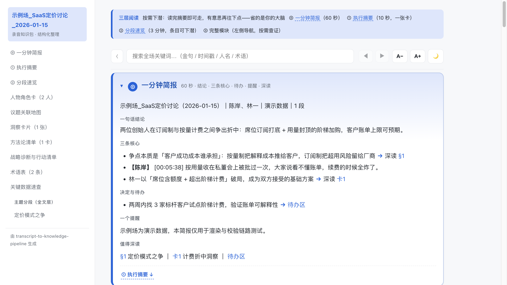

# transcript-to-knowledge-pipeline

[](./LICENSE)
[](https://www.python.org)
[]()
[](./CHANGELOG.md)

> 把一份对话录音转写稿，清洗成 **9 模块知识包 + 双击即开、可全文搜索的 HTML** —— 每条金句可回跳原文时间戳的 Claude Code skill。



**30 秒体验**（不用安装）：打开 [在线示例 HTML](https://guoleiycyc-sketch.github.io/transcript-to-knowledge-pipeline/demo.html) → `Ctrl+F` 搜任意词 → 点一条金句看它带时间戳的出处。想看它的原料长什么样？对照 [这份原始转写稿](./example/示例场_SaaS定价讨论_2026-01-15/01_清洗稿.md)。

## 它解决什么问题

会议录音转写稿的痛点：**说话人标签混乱、口水话淹没干货、AI 总结不敢信、事后找不到「那句原话在哪」**。本 skill 不做一键摘要，而是走一条严格的清洗管线：说话人映射 → 逐回合还原 → 结构化提炼 → 机器核证——产出的每条金句都能逐字回溯到原文时间戳。

## 特性

- **中文清洗质量** // 说话人映射零误判（角色指纹+时间线+二次确认，覆盖 8 类陷阱）；ASR 订正对照表，不确定的标 `[ASR/存疑]` 绝不臆造
- **可验证的忠实性** // `verify_quotes.py` 引文逐字核证 + `audit_content.py` 四类一致性审计（数据覆盖/死线漏收/Owner 冲突）——AI 改了什么，机器说了算
- **四层阅读 HTML** // ⓪ 一分钟简报 → ① 执行摘要（10 秒决策）→ ② 分段速览 → ③ 完整模块，单文件离线、全文搜索、金句点击复制、深浅主题、打印友好
- **省成本** // 子代理委派模式：清洗稿由轻量模型子代理并行生产，主对话只做映射裁决+质检+提炼，实测主对话成本降约 70%
- **零依赖** // python3 标准库即可，`selftest.py` 装机 30 秒端到端验证；57 条实战坑库全部来自真实翻车

<details>
<summary><b>更多能力</b>（六档产出 / 脱敏分享版 / 跨场知识库 / 培训讲义渲染）</summary>

- **六档产出**：极轻/轻/轻加强/专项/标准/重装，按决策密度×外部受众×资产含量分档
- **脱敏分享版**：`render_pack.py --share` 出价格/健康级引语剔除+人名化名的外发版；`diff_report.py` 清洗忠实度审计一页凭证
- **跨场全局层**：`extract_atoms.py` 抽取原子知识，`render_views.py` 出跨场视图
- **培训讲义渲染**：`render_coursebook.py` 把讲授型场次双渲为讲师版/学员版（脱敏+打印留白+红线闸）
- **先验名单**：开工提示参会人名单+背景，映射从盲配变验配

</details>

## 快速开始

前置：[Claude Code](https://docs.anthropic.com/en/docs/claude-code) + python3（无需 pip install）。

```bash
# 1. 安装 skill
git clone https://github.com/guoleiycyc-sketch/transcript-to-knowledge-pipeline.git \
  ~/.claude/skills/transcript-to-knowledge-pipeline

# 2. 验证装机（30 秒）
python3 ~/.claude/skills/transcript-to-knowledge-pipeline/scripts/selftest.py

# 3. 给它一份转写稿
#    在 Claude Code 里说：「用 transcript-to-knowledge-pipeline 清洗这份转写稿：<你的md/txt路径>」
```

产出结构（每场一个目录）：

```
<场次名>_YYYY-MM-DD/
├── 00_执行摘要.md / 00a_一分钟简报.md   # 10 秒 / 60 秒决策层
├── 01_清洗稿.md                        # 素材真身：逐回合还原，全部引文的核证源头
├── 02_主题整理/ … 09_行动清单.md        # 议题重组 / 方法论 / 人物卡 / 数据 / 洞察 / 待办
└── <场次名>.html                       # 主交付物：双击即开
```

## FAQ

| 问题 | 回答 |
|---|---|
| 和直接让 AI 总结有什么区别？ | 每条产出可回溯：金句带时间戳、引文逐字核证、机器闸门拦「编造/漏收/张冠李戴」——总结错了能查出来 |
| 清洗一场要多久/多少钱？ | 委派模式下主对话只做裁决与提炼；一场 2 小时录音实测主对话成本约为直洗的 30% |
| 支持哪些转写来源？ | 飞书妙记 / 腾讯会议 / 得到大脑 / Whisper / 手工整理稿，多场次同日合并清洗亦可 |

## 文档

- 完整用法与产物契约：[`SKILL.md`](./SKILL.md) · [`INSTALL.md`](./INSTALL.md)
- 设计文档与各阶段规范：[`references/`](./references/)（映射方法论 / 坑库 / 子代理模式 / 评审协议）
- 变更史：[`CHANGELOG.md`](./CHANGELOG.md) · [Releases](https://github.com/guoleiycyc-sketch/transcript-to-knowledge-pipeline/releases)

## License

[MIT](./LICENSE)
